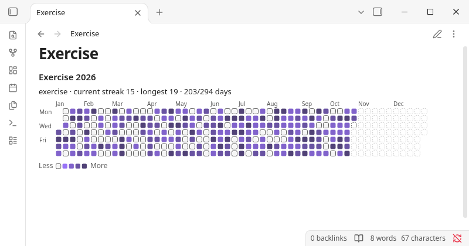
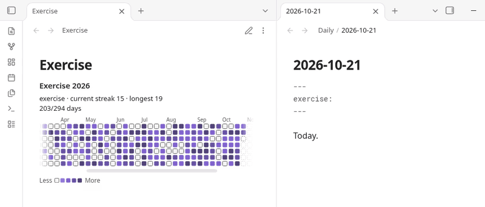
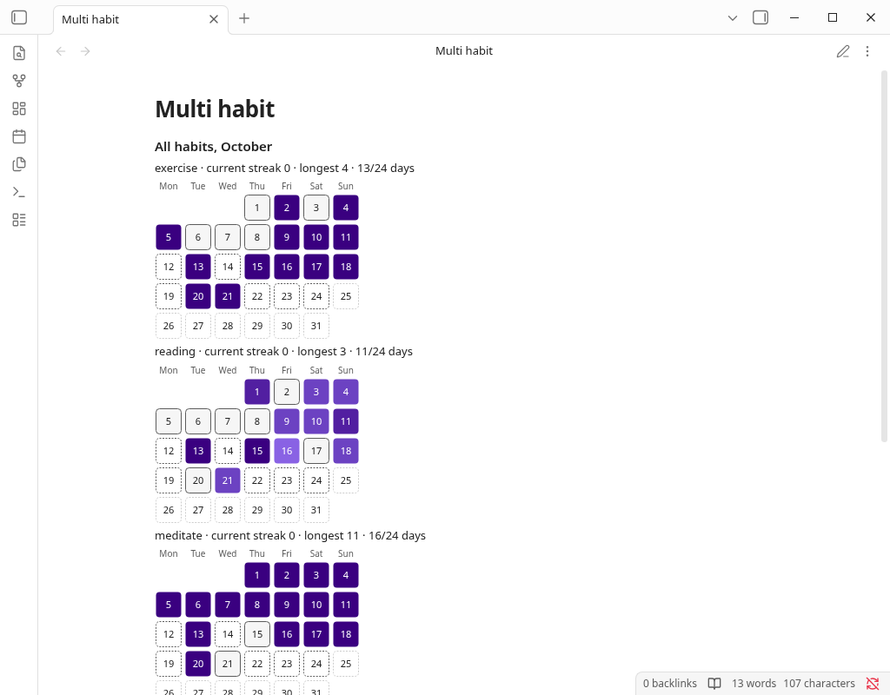
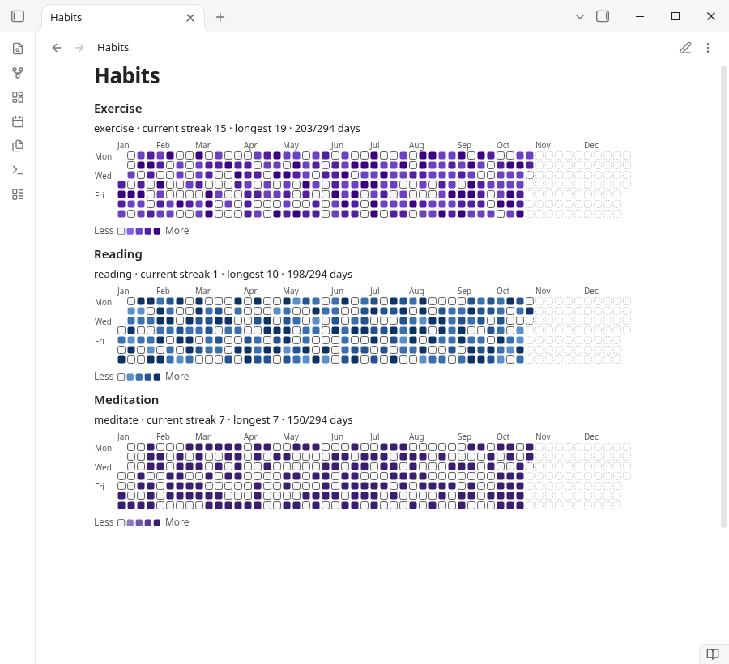

# Streakwise

Turn the habit properties already in your daily notes, like `exercise: 30 min` or `reading: true`, into a GitHub-style yearly heatmap with your current and longest streak, with no new note format to learn.

For anyone who tracks habits in daily notes and wants a visual check without adding a separate app. The yearly heatmap is free and works offline. Pro adds more views, multiple habits per block, and PNG export.





## Features

- Yearly heatmap of one habit per block, with current streak, longest streak and days done.
- Several blocks in one note, each with its own habit and colours.
- Follows your theme: the default "Accent" colours use your theme's accent colour; 4 fixed palettes (green, blue, purple, orange) are also available. Higher values get darker in light themes and brighter in dark themes, so levels can be read by lightness, not hue alone.
- Works in narrow panes: the grid scrolls to today, and the title and streak line wrap.
- The free features work fully offline (see Network use disclosure for Pro).

**Streakwise Pro (one-time purchase, includes all future updates, US$19 plus tax where applicable):**
- Month and week views: see this week at a glance without scrolling a whole year. Quarter and year-to-date views too.
- Several habits in one block: exercise, reading and sleep side by side.
- PNG export: drop your year into a review note or share it (generated locally, no upload).

Pro periodically checks your license online (at most once a day) and works offline for up to 7 days. Use it on up to 5 devices; full refund within 14 days.





## Usage

Add `exercise: true`, `reading: 30 min`, `meditate: yes` (any property name) to daily notes, then:

````markdown
```streakwise
habits: exercise
view: year
```
````

| Option | Values | Default |
|---|---|---|
| `habits` | one frontmatter property (case-insensitive); several, comma-separated: Pro | default habit from settings |
| `view` | `year` (`ytd`, `quarter`, `month`, `week`: Pro) | `year` |
| `date` / `year` | `YYYY-MM-DD` / `YYYY`, which year to show | today |
| `colors` | `accent`, `green`, `blue`, `purple`, `orange` | from settings (`accent`) |
| `max` | value shown in the darkest colour | largest value in range |
| `title` | any text | none |
| `weekstart` | `monday`, `sunday` | from settings |

Values:
- `true/yes/done/x/✅` = done; `false/no/skip` or empty = not done.
- Numbers are amounts, also with units (`30 min`, `1.5h`). Zero or negative numbers (`-5`) count as not done.
- Comma: a comma followed by exactly three digits is a thousands separator (`1,000` = 1000, `12,500 steps` = 12500); any other comma is a decimal comma (`1,5` = 1.5, `1,50` = 1.5, `1,0000` = 1). To avoid ambiguity, write decimals with a dot (`1.50`).
- A missing daily note or property is shown faded as "no entry".

**Where daily notes are found:** Streakwise follows the folder and date format of the Periodic Notes plugin (daily notes) if enabled, otherwise the core Daily notes plugin, otherwise the folder/format in Streakwise settings. You can force the custom location in settings.

Only notes **inside the daily-notes folder or its subfolders** are counted. A note matches if its path relative to that folder (for formats like `YYYY/MM/YYYY-MM-DD`) or its file name (for notes archived in subfolders, e.g. `Daily/2026/2026-10-17.md`) matches the date format. Notes outside the folder (e.g. `Archive/2026-10-17.md` when the folder is `Daily`) are ignored. If no daily notes are found, the note shows one hint card with the folder and format it looked for and a button that opens Streakwise settings. If two notes still map to the same day (e.g. format `YYYY-M-D` with both `2026-10-7.md` and `2026-10-07.md`), the one with the **shortest path** is used (ties: alphabetical), and blocks whose date range includes that day show which note was ignored.

The command **Insert heatmap block** adds a starter block.

## Payment disclosure

- **Optional payments.** The yearly heatmap is free and complete. Streakwise Pro is an optional one-time upgrade.
- **One-time purchase, includes all future updates.** No subscription, and your key doesn't expire. Pro checks the key with Polar periodically (at most once a day when you're online) and keeps working for up to **7 days offline**.
- Streakwise Pro costs **US$19 (plus VAT/sales tax where applicable, calculated and shown at checkout)** and is sold through **Polar** (https://polar.sh), which acts as the merchant of record and handles payment, tax and invoices. Polar emails you a license key. Obsidian does not sell or handle this payment.
- No account is required to use the plugin. The **Buy Pro** button opens https://formchime.com/api/checkout?product=streakwise-pro, which redirects to a Polar checkout; checkout creates a customer record with Polar (email).
- A key can be active on **5 devices**. A new device does not activate by itself: paste the key in Settings → Streakwise → Pro license and press **Activate**. Need a 6th device? Deactivate an old one in the Polar customer portal (https://polar.sh/formchime/portal), then press **Activate** on the new device. A device released in the portal locks Pro at its next online check and is **not** re-activated automatically; press **Activate** there if you want it back. Pressing **Remove** in Streakwise also releases that device's slot (if the release can't reach Polar, the key is still removed locally and you can release the slot in the portal).
- **Refunds:** Full refund within 14 days, just email support@formchime.com (or reply to your Polar receipt email). After a refund the license key is revoked and Pro features lock again; the free yearly heatmap keeps working.
- Not available in Japan. If you were charged from Japan by mistake, email support@formchime.com for a full refund. The free features work everywhere.

## Network use disclosure

- **No network requests are made unless you open the Pro settings panel or enter a license key.** All heatmap, streak and PNG export features run locally.
- When you open **Settings → Streakwise → Pro license** without an active Pro key, Streakwise sends one `GET https://formchime.com/api/region` request to check whether Pro can be sold in your region (nothing else is sent). This request sends your IP address to formchime.com, which reads only the country Cloudflare derives from it; formchime.com does not log or store your IP. When you press Buy Pro, formchime.com passes your IP to Polar to create the checkout (tax and fraud checks). formchime.com privacy policy: https://formchime.com/streakwise/privacy. If the answer is "blocked", the Buy Pro button is hidden. If the request fails, the button is still shown.
- With a key, when you press **Activate** and then at most **once a day** on startup (or on every startup while a stored key is not currently unlocking Pro, so Pro comes back as soon as you're online), Streakwise contacts Polar:
  - `POST https://api.polar.sh/v1/customer-portal/license-keys/activate` — reserves one of the key's 5 device slots (sends the key, our public Polar organization ID and a device label such as "Obsidian – macOS – a1b2": app, platform and a random 4-character device code, shown in settings as "This device", so you can tell devices apart in the portal; no vault name, user name or host name).
  - `POST https://api.polar.sh/v1/customer-portal/license-keys/deactivate` — only when you press **Remove**; releases this device's slot (sends the key, organization ID and activation ID).
  - `POST https://api.polar.sh/v1/customer-portal/license-keys/validate` — confirms the key (sends the key, organization ID and activation ID).
- Nothing from your vault is sent: no note content, file names or habit data.
- Offline: after a successful check, Pro stays unlocked for **7 days** without internet.
- No telemetry, analytics or ads. Polar privacy policy: https://polar.sh/legal/privacy

## Data storage

- Settings and the cached license result are stored in `.obsidian/plugins/streakwise/data.json` in your vault.
- **License key:** on Obsidian 1.11.4+ it is stored in Obsidian's **Keychain** (Settings → Keychain, ID `streakwise-license-key`), not in vault files, so it is not synced or committed with your notes. Encryption comes from the operating system's secret store; if none is available (e.g. some Linux setups), Obsidian keeps Keychain secrets unencrypted (on Linux without a keyring/secret service, the key ends up in plain text in Obsidian's own profile storage). On Obsidian versions before 1.11.4 the key is stored in plain text in `data.json`, so it travels with your vault if you sync it or keep it in git; the settings tab warns about this, and we recommend updating Obsidian. Keys saved by earlier builds are migrated automatically.
- The random device code is kept in Obsidian's local storage on this device (not in `data.json`), so each device keeps its own code even if your vault syncs.
- Exported PNGs go to the folder set in settings (default `Streakwise exports/`).
- No files outside your vault are read or written (besides Obsidian's own Keychain).

## Known limits

- Only frontmatter properties are read (not task checkboxes in the note body).
- The offline grace period uses your device clock; setting the clock back can extend it.

## Development

This branch builds the paid version (`FREE_BUILD=false`); see Network use disclosure. The free v0.1.x build strips the license code (`FREE_BUILD=true`), and `npm test` checks that.

```bash
npm install
npm run build   # type-check + bundle to main.js
npm test        # unit tests (dates, values, streaks, settings validation, colour contrast, licensing with mocked HTTP)
                # + a check that a FREE_BUILD=true bundle contains no license or network code
npm run lint
```

## Support

Bugs and questions: open an issue at https://github.com/smallbench-labs/streakwise/issues. Billing and refunds: support@formchime.com.

## Clean-room statement

Written from scratch.

## License

MIT © 2026 Smallbench Labs (Roger Chang) (see LICENSE).
