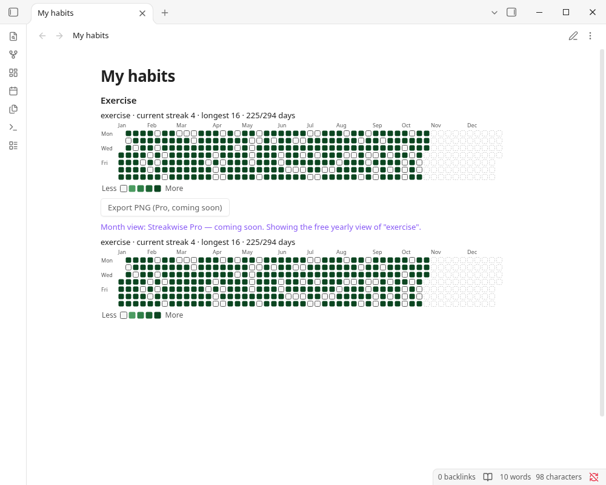
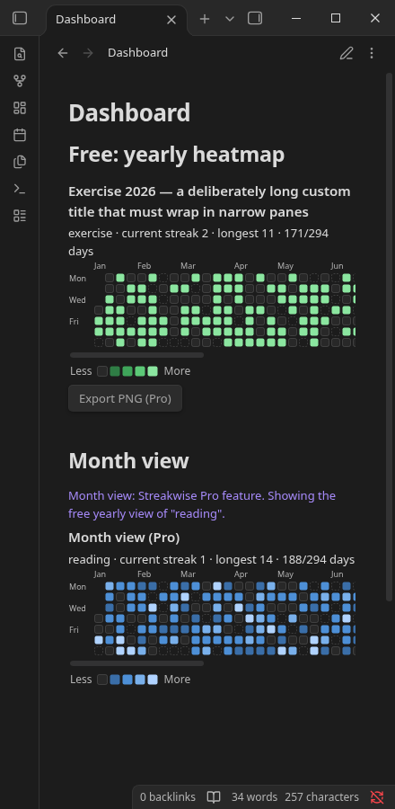

# Streakwise

See at a glance whether you kept your habits. Streakwise turns the properties you already log in your daily notes, like `exercise: true` or `reading: 30 min`, into a heatmap with your current and longest streak.

For anyone who tracks habits in daily notes and wants a visual check without adding a separate app. The yearly heatmap is free and works offline. Pro features coming soon: more views, multiple habits per block, and PNG export.



## Features

**Free (fully offline, no account, no network):**
- Yearly heatmap of one habit, with current streak, longest streak and days done.
- Light and dark theme support. 4 colour palettes (green, blue, purple, orange); shades get darker as values rise, so levels can be read by lightness, not hue alone.

**Streakwise Pro (coming soon):**
- Month, week, quarter and year-to-date views.
- Several habits in one block.
- Export a heatmap as PNG into your vault (generated locally, no upload).



## Usage

Add `exercise: true`, `reading: 30 min`, `meditate: yes` (any property name) to daily notes, then:

````markdown
```streakwise
habits: exercise, reading
view: month
```
````

| Option | Values | Default |
|---|---|---|
| `habits` | comma-separated frontmatter properties (case-insensitive) | default habit from settings |
| `view` | `year`, `ytd`, `quarter`, `month`, `week` | `year` |
| `date` / `year` | `YYYY-MM-DD` / `YYYY`, which period to show. Ignored by `view: ytd`, which always shows 1 January to today of the current year | today |
| `colors` | `green`, `blue`, `purple`, `orange` | from settings |
| `max` | value shown in the darkest colour | largest value in range |
| `title` | any text | none |
| `weekstart` | `monday`, `sunday` | from settings |

Values:
- `true/yes/done/x/✅` = done; `false/no/skip` or empty = not done.
- Numbers are amounts, also with units (`30 min`, `1.5h`). Zero or negative numbers (`-5`) count as not done.
- Comma: `1,5` is read as a decimal comma (1.5). Groups of exactly three digits are thousands: `1,000` = 1000, `12,500 steps` = 12500.
- A missing daily note or property is shown faded as "no entry".

**Where daily notes are found:** Streakwise follows the folder and date format of the Periodic Notes plugin (daily notes) if enabled, otherwise the core Daily notes plugin, otherwise the folder/format in Streakwise settings. You can force the custom location in settings.

Only notes **inside the daily-notes folder or its subfolders** are counted. A note matches if its path relative to that folder (for formats like `YYYY/MM/YYYY-MM-DD`) or its file name (for notes archived in subfolders, e.g. `Daily/2026/2026-10-17.md`) matches the date format. Notes outside the folder (e.g. `Archive/2026-10-17.md` when the folder is `Daily`) are ignored. If no daily notes are found, the block says so and shows the folder and format it looked for. If two notes still map to the same day (e.g. format `YYYY-M-D` with both `2026-10-7.md` and `2026-10-07.md`), the one with the **shortest path** is used (ties: alphabetical), and blocks whose date range includes that day show which note was ignored.

The command **Insert heatmap block** adds a starter block.

## Network use disclosure

- **Streakwise makes no network requests.** All heatmap and streak features run locally.
- Nothing from your vault is sent anywhere. No telemetry, analytics or ads.

## Data storage

- Settings are stored in `.obsidian/plugins/streakwise/data.json` in your vault.
- No files outside your vault are read or written.

## Known limits

- Only frontmatter properties are read (not task checkboxes in the note body).

## Development

```bash
npm install
npm run build   # type-check + bundle to main.js
npm test        # unit tests for date/value/streak/scale/config logic and licensing (mocked HTTP + clock; free-only build makes no requests)
npm run lint
```

## Support

Bugs and questions: open an issue at https://github.com/smallbench-labs/streakwise/issues. Other questions: support@formchime.com.

## Clean-room statement

Written from scratch; see REVIEW_NOTES.md.

## License

MIT © 2026 Smallbench Labs (Roger Chang) (see LICENSE).
