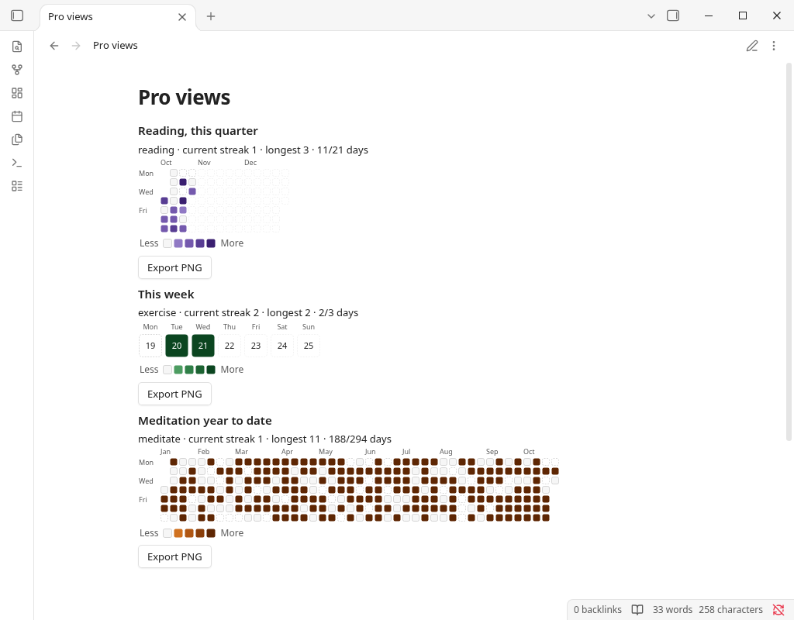
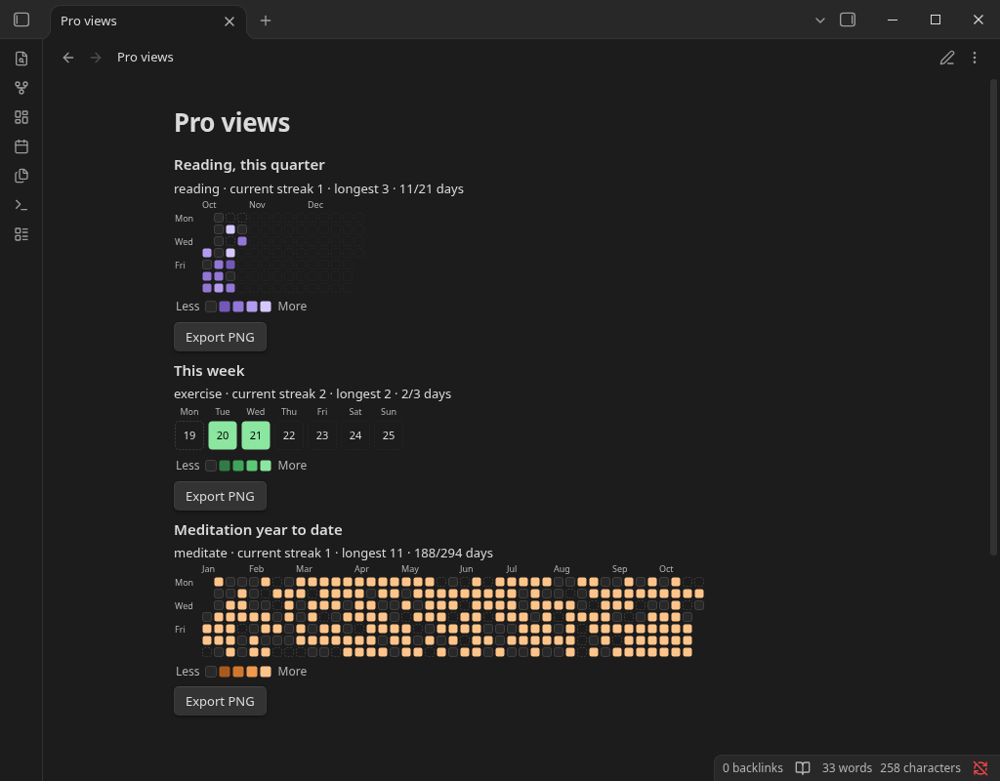

# Streakwise

See at a glance whether you kept your habits. Streakwise turns the properties you already log in your daily notes, like `exercise: true` or `reading: 30 min`, into a heatmap with your current and longest streak.

For anyone who tracks habits in daily notes and wants a visual check without adding a separate app. The yearly heatmap is free and works offline. Pro adds more views, multiple habits per block, and PNG export.


## Features

**Free (fully offline, no account, no network):**
- Yearly heatmap of one habit, with current streak, longest streak and days done.
- Light and dark theme support. 4 colour palettes (green, blue, purple, orange); shades get darker as values rise, so levels can be read by lightness, not hue alone.

**Streakwise Pro (one-time purchase, US$19):**
- Month, week, quarter and year-to-date views.
- Several habits in one block.
- Export a heatmap as PNG into your vault (generated locally, no upload).





## Usage

Add `exercise: true`, `reading: 30 min`, `meditate: yes` (any property name) to daily notes, then:

````markdown
```streakwise
habits: exercise, reading
view: month
```
````

| Option | Values | Default |
|---|---|---|
| `habits` | comma-separated frontmatter properties (case-insensitive) | default habit from settings |
| `view` | `year`, `ytd`, `quarter`, `month`, `week` | `year` |
| `date` / `year` | `YYYY-MM-DD` / `YYYY`, which period to show. Ignored by `view: ytd`, which always shows 1 January to today of the current year | today |
| `colors` | `green`, `blue`, `purple`, `orange` | from settings |
| `max` | value shown in the darkest colour | largest value in range |
| `title` | any text | none |
| `weekstart` | `monday`, `sunday` | from settings |

Values:
- `true/yes/done/x/✅` = done; `false/no/skip` or empty = not done.
- Numbers are amounts, also with units (`30 min`, `1.5h`). Zero or negative numbers (`-5`) count as not done.
- Comma: `1,5` is read as a decimal comma (1.5). Groups of exactly three digits are thousands: `1,000` = 1000, `12,500 steps` = 12500.
- A missing daily note or property is shown faded as "no entry".

**Where daily notes are found:** Streakwise follows the folder and date format of the Periodic Notes plugin (daily notes) if enabled, otherwise the core Daily notes plugin, otherwise the folder/format in Streakwise settings. You can force the custom location in settings.

Only notes **inside the daily-notes folder or its subfolders** are counted. A note matches if its path relative to that folder (for formats like `YYYY/MM/YYYY-MM-DD`) or its file name (for notes archived in subfolders, e.g. `Daily/2026/2026-10-17.md`) matches the date format. Notes outside the folder (e.g. `Archive/2026-10-17.md` when the folder is `Daily`) are ignored. If no daily notes are found, the block says so and shows the folder and format it looked for. If two notes still map to the same day (e.g. format `YYYY-M-D` with both `2026-10-7.md` and `2026-10-07.md`), the one with the **shortest path** is used (ties: alphabetical), and blocks whose date range includes that day show which note was ignored.

The command **Insert heatmap block** adds a starter block.

## Payment disclosure

- Payment: optional. The yearly heatmap is free and fully functional.
- Streakwise Pro is a **one-time purchase (US$19)** sold through **Polar** (https://polar.sh), which acts as the merchant of record and handles payment, tax and invoices. Polar emails you a license key. Obsidian does not sell or handle this payment.
- No account is required to use the plugin. Checkout creates a customer record with Polar (email).
- A key can be active on **5 devices**. To move it, deactivate an old device in the Polar customer portal; Streakwise re-activates automatically on its next check.
  <!-- TODO(M7): link the real Polar customer portal URL here, and set organizationId/portalUrl in src/license/licenseManager.ts before release. -->
- Pro is a one-time purchase: keys do not expire.
- **Refunds:** Full refund within 14 days of purchase, no questions asked. Request it by replying to your Polar receipt email or writing to support@formchime.com. After a refund the license key is revoked and Pro features lock again; the free yearly heatmap keeps working.
<!-- TODO(M4): add "Streakwise Pro is currently not sold to customers in Japan. The free features work everywhere." only after a Polar test checkout confirms Japanese billing addresses are blocked. -->

## Network use disclosure

- **No network requests are made unless you enter a license key.** All heatmap, streak and PNG export features run locally.
- With a key, when you press **Activate** and then at most **once a day** on startup, Streakwise contacts Polar:
  - `POST https://api.polar.sh/v1/customer-portal/license-keys/activate` — reserves one of the key's 5 device slots (sends the key, our public Polar organization ID and the label "Obsidian").
  - `POST https://api.polar.sh/v1/customer-portal/license-keys/validate` — confirms the key (sends the key, organization ID and activation ID).
- Nothing from your vault is sent: no note content, file names or habit data.
- Offline: after a successful check, Pro stays unlocked for **7 days** without internet.
- No telemetry, analytics or ads. Polar privacy policy: https://polar.sh/legal/privacy

## Data storage

- Settings and the cached license result are stored in `.obsidian/plugins/streakwise/data.json` in your vault.
- **License key:** on Obsidian 1.11.4+ it is stored in Obsidian's **Keychain** (Settings → Keychain, ID `streakwise-license-key`), not in vault files, so it is not synced or committed with your notes. Encryption comes from the operating system's secret store; if none is available (e.g. some Linux setups), Obsidian keeps Keychain secrets unencrypted. On older Obsidian versions the key is stored in `data.json`. Keys saved by earlier builds are migrated automatically.
- Exported PNGs go to the folder set in settings (default `Streakwise exports/`).
- No files outside your vault are read or written (besides Obsidian's own Keychain).

## Known limits

- Only frontmatter properties are read (not task checkboxes in the note body).
- The offline grace period uses your device clock; setting the clock back can extend it.

## Development

```bash
npm install
npm run build   # type-check + bundle to main.js
npm test        # unit tests for date/value/streak/scale/config logic and licensing (mocked HTTP + clock)
npm run lint
```

## Support

Bugs and questions: open an issue at https://github.com/smallbench-labs/streakwise/issues. Billing and refunds: support@formchime.com.

## Clean-room statement

Written from scratch; see REVIEW_NOTES.md.

## License

MIT © 2026 Smallbench Labs (Roger Chang) (see LICENSE).
