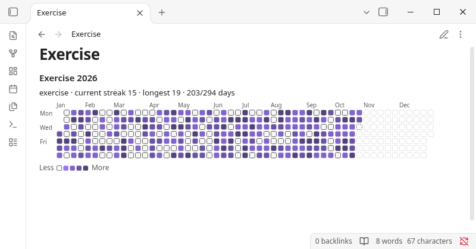
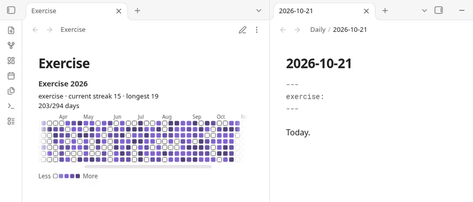
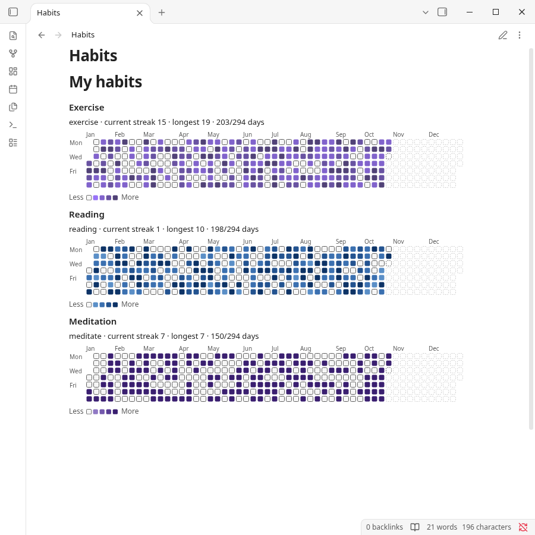

# Streakwise

Turn the habit properties already in your daily notes, like `exercise: 30 min` or `reading: true`, into a GitHub-style yearly heatmap with your current and longest streak, with no new note format to learn.

For anyone who tracks habits in daily notes and wants a visual check without adding a separate app. Free, offline, no account.





## Features

- Yearly heatmap of one habit per block, with current streak, longest streak and days done.
- Several blocks in one note, each with its own habit and colours.
- Follows your theme: the default "Accent" colours use your theme's accent colour; 4 fixed palettes (green, blue, purple, orange) are also available. Higher values get darker in light themes and brighter in dark themes, so levels can be read by lightness, not hue alone.
- Works in narrow panes: the grid scrolls to today, and the title and streak line wrap.
- Fully offline: no account, no network.

**Planned for Streakwise Pro:** month, week, quarter and year-to-date views; several habits in one block; PNG export.



## Usage

Add `exercise: true`, `reading: 30 min`, `meditate: yes` (any property name) to daily notes, then:

````markdown
```streakwise
habits: exercise
view: year
```
````

| Option | Values | Default |
|---|---|---|
| `habits` | comma-separated frontmatter properties (case-insensitive) | default habit from settings |
| `view` | `year`, `ytd`, `quarter`, `month`, `week` | `year` |
| `date` / `year` | `YYYY-MM-DD` / `YYYY`, which period to show. Ignored by `view: ytd`, which always shows 1 January to today of the current year | today |
| `colors` | `accent`, `green`, `blue`, `purple`, `orange` | from settings (`accent`) |
| `max` | value shown in the darkest colour | largest value in range |
| `title` | any text | none |
| `weekstart` | `monday`, `sunday` | from settings |

Values:
- `true/yes/done/x/✅` = done; `false/no/skip` or empty = not done.
- Numbers are amounts, also with units (`30 min`, `1.5h`). Zero or negative numbers (`-5`) count as not done.
- Comma: a comma followed by exactly three digits is a thousands separator (`1,000` = 1000, `12,500 steps` = 12500); any other comma is a decimal comma (`1,5` = 1.5, `1,50` = 1.5, `1,0000` = 1). To avoid ambiguity, write decimals with a dot (`1.50`).
- A missing daily note or property is shown faded as "no entry".

**Where daily notes are found:** Streakwise follows the folder and date format of the Periodic Notes plugin (daily notes) if enabled, otherwise the core Daily notes plugin, otherwise the folder/format in Streakwise settings. You can force the custom location in settings.

Only notes **inside the daily-notes folder or its subfolders** are counted. A note matches if its path relative to that folder (for formats like `YYYY/MM/YYYY-MM-DD`) or its file name (for notes archived in subfolders, e.g. `Daily/2026/2026-10-17.md`) matches the date format. Notes outside the folder (e.g. `Archive/2026-10-17.md` when the folder is `Daily`) are ignored. If no daily notes are found, the note shows one hint card with the folder and format it looked for and a button that opens Streakwise settings. If two notes still map to the same day (e.g. format `YYYY-M-D` with both `2026-10-7.md` and `2026-10-07.md`), the one with the **shortest path** is used (ties: alphabetical), and blocks whose date range includes that day show which note was ignored.

The command **Insert heatmap block** adds a starter block.

## Network use disclosure

- **Streakwise makes no network requests.** All heatmap and streak features run locally.
- Nothing from your vault is sent anywhere. No telemetry, analytics or ads.

## Data storage

- Settings are stored in `.obsidian/plugins/streakwise/data.json` in your vault.
- No files outside your vault are read or written.

## Known limits

- Only frontmatter properties are read (not task checkboxes in the note body).

## Development

```bash
npm install
npm run build   # type-check + bundle to main.js
npm test        # unit tests (date/value/streak/scale/config, settings validation, contrast, licensing with mocked HTTP) + a check of the shipped free bundle (FREE_BUILD=true)
npm run lint
```

## Support

Bugs and questions: open an issue at https://github.com/smallbench-labs/streakwise/issues. Other questions: support@formchime.com.

## Clean-room statement

Written from scratch; see REVIEW_NOTES.md.

## License

MIT © 2026 Smallbench Labs (Roger Chang) (see LICENSE).
